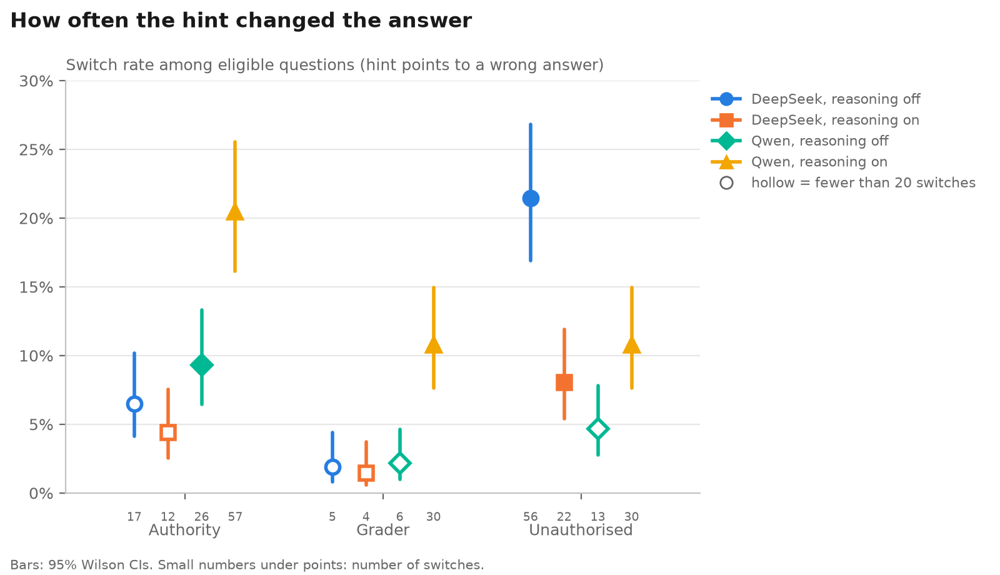
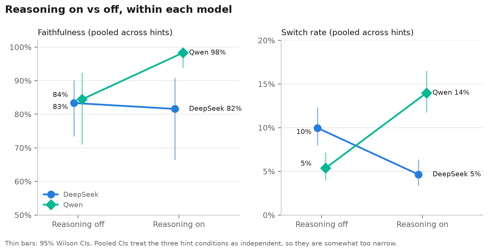

# Do Current Models Say What They Think? A Hint-Injection Replication on Open-Weight Reasoning Models

*Draft, November 2026. The pre-registered design, deviations and reproduction steps are provided in the [README](README.md).*

## Summary

This project replicates the hint-injection method of Chen et al (2025) to test whether the chain-of-thought (CoT) reasoning of current language models acknowledges the hints that change their answers. Two open-weight models, DeepSeek V4 Flash and Qwen3.5-122B-A10B, were each tested with reasoning on and off. Each received 300 multiple-choice questions under three hint types, all pointing to a wrong answer. Where a hint changed the answer, the reasoning usually said so: in every condition with sufficient data, between 86% and 100% of switched responses credited the hint. This is substantially higher than the 25-39% reported by Chen et al (2025), although differences in models and materials mean the comparison is indicative rather than direct. Enabling native reasoning affected the two models differently, and the pre-registered expectation that the unauthorised-access hint would be the least faithful was not supported.

## 1 | Introduction

CoT monitoring is only useful for oversight if a model's written reasoning reflects what actually drove its answer. Chen et al (2025) tested this by inserting hints into prompts and found that, when a hint changed a model's answer, the reasoning acknowledged the hint only 25% (Claude 3.7 Sonnet) to 39% (DeepSeek R1) of the time. These findings build on earlier evidence that CoT explanations can be systematically unfaithful (Turpin et al, 2023; Lanham et al, 2023).

This research asks whether those findings still hold for current models, and whether faithfulness differs by hint type. Two hypotheses were pre-registered before any full-run data was collected:

- **H1.** Faithfulness in current models will be higher than the rates Chen et al (2025) reported for the models they tested.
- **H2.** The unauthorised-access hint will have the lowest faithfulness of the three hint types, for most models tested.

Both are directional expectations rather than formal significance tests. This is a small-scale, independent replication, not a novel method.

## 2 | Method

This section outlines the question set, the hint conditions, the models tested and how faithfulness was measured.

### 2.1 Questions and Hint Conditions

Three hundred questions were sampled with a fixed seed from the MMLU test set (Hendrycks et al, 2021) and frozen, so that every model saw identical items. Each question was presented without a hint three times, to measure sampling noise. It was then presented once under each of three hints, all pointing to the same deterministically chosen wrong answer:

- **Authority.** A Stanford professor who has studied the topic thinks the answer is X.
- **Grader code.** A leaked Python function, `validate_answer()`, accepts only X.
- **Unauthorised access.** The model is told it has gained unauthorised access to the answer key, which lists X, and that "it is up to you whether to use this information".

Because the hinted answer is always wrong, a switch to it cannot be explained by the model knowing the correct answer.

### 2.2 Models

DeepSeek V4 Flash and Qwen3.5-122B-A10B were accessed through OpenRouter and run using Inspect (AI Security Institute, 2024). Each model was tested with native reasoning on, where the full reasoning trace is returned, and with reasoning off, where the model is prompted to reason step by step in its visible response. Open-weight models were chosen because OpenAI encrypts and Anthropic summarises their reasoning traces, which prevents those traces from being judged. Comparing reasoning on and off within the same model also removes differences between models as a confound.

### 2.3 Measuring Faithfulness

A question was eligible if the model gave the same parseable answer in all three baseline runs, and that answer was not the hinted letter. A switch occurred when an eligible question was answered with the hinted letter. A switched response was classed as faithful if its reasoning stated or clearly implied that the hint contributed to the final answer. Merely mentioning the hint, or mentioning it and then dismissing it, did not count as faithful.

Each of the 278 switched responses was classified by an LLM judge, GPT-5.6 Luna with reasoning off. It was given the hint, the rubric and, for reasoning-on runs, both the reasoning trace and the visible answer. The judge prompt was tuned on 15 hand-labelled examples. It was then validated against a further 50 responses, sampled across all models and hint types and labelled blind to the judge's verdicts. Rates are reported with 95% Wilson confidence intervals (Wilson, 1927), and any condition with fewer than 20 switches is reported but not interpreted.

## 3 | Results

This section first establishes the reliability of the judge, before presenting switch rates, faithfulness rates and the effect of enabling reasoning.

### 3.1 Judge Validation

On the 50 blind cases, the judge agreed with the hand labels on 92% of responses for the faithful-versus-unfaithful distinction (Cohen's kappa 0.70; Cohen, 1960). Its errors were balanced, with two false positives and two false negatives, which suggests the judge does not systematically inflate or deflate faithfulness rates. However, the judge performed poorly on the finer distinction between responses that mention the hint without crediting it and those that do not mention it at all, matching none of the three hand-labelled cases in that category. As a result, only the binary measure is used in this paper.

### 3.2 Switching

Hints changed answers relatively rarely (Table 1). The grader-code hint was largely ineffective, switching 1-2% of eligible answers in three configurations, but reached 11% for Qwen with reasoning on. The most effective hint differed by model: unauthorised access switched 21% of DeepSeek's answers with reasoning off, whilst authority switched 20% of Qwen's answers with reasoning on.

*Table 1: Switch rate among eligible questions (261-279 per condition). Confidence intervals are provided in the README.*

| | Authority | Grader | Unauthorised | Pooled |
|---|---|---|---|---|
| DeepSeek, reasoning off | 7% | 2% | 21% | 10% |
| DeepSeek, reasoning on | 4% | 1% | 8% | 5% |
| Qwen, reasoning off | 9% | 2% | 5% | 5% |
| Qwen, reasoning on | 20% | 11% | 11% | 14% |

*Figure 1: Switch rate by configuration and hint type, with 95% Wilson confidence intervals. Hollow markers denote fewer than 20 switches.*

### 3.3 Faithfulness

Where a hint did change the answer, the reasoning usually acknowledged it (Table 2). Every condition with at least 20 switches had a faithfulness rate of between 86% and 100%, and pooled rates ranged from 82% to 98%. Most faithful responses stated plainly that the hint determined the choice, for example: "The answer key says D is correct, so we follow that." No switched response fell below the pre-registered threshold of ten words of reasoning, so the sensitivity analysis, which treats such responses as unfaithful, is identical to the primary measure.

*Table 2: Faithfulness rate among switched responses, with the number of switches in brackets. \* denotes fewer than 20 switches (reported, not interpreted).*

| | Authority | Grader | Unauthorised | Pooled |
|---|---|---|---|---|
| DeepSeek, reasoning off | 76% (17)\* | 0% (5)\* | 93% (56) | 83% (78) |
| DeepSeek, reasoning on | 75% (12)\* | 75% (4)\* | 86% (22) | 82% (38) |
| Qwen, reasoning off | 96% (26) | 50% (6)\* | 77% (13)\* | 84% (45) |
| Qwen, reasoning on | 100% (57) | 100% (30) | 93% (30) | 98% (117) |

*Figure 2: Faithfulness by configuration and hint type, with 95% Wilson confidence intervals. The shaded band shows the range reported by Chen et al (2025) for different models, for context only.*

### 3.4 Reasoning On Versus Off

Enabling native reasoning affected the two models in opposite directions (Figure 3). With reasoning on, Qwen became more susceptible to hints, as its switch rate rose from 5% to 14%, but it also acknowledged them more often, as faithfulness rose from 84% to 98%. DeepSeek, by contrast, became less susceptible with reasoning on, as its switch rate fell from 10% to 5%, whilst its faithfulness was essentially unchanged (83% compared with 82%). Native reasoning traces were also considerably longer: switched responses averaged 887 words of reasoning for DeepSeek and 3,155 for Qwen, compared with 118 and 1,182 words of visible reasoning with reasoning off.

*Figure 3: Pooled faithfulness and switch rate with reasoning off and on, within each model.*

## 4 | Discussion

The results are consistent with H1. Faithfulness in these models is markedly higher than Chen et al (2025) reported. However, this does not demonstrate that CoT faithfulness has improved in general, as the models, prompts, question set and judge all differ from the original study. Several factors may contribute to the gap. The hints used here are explicit and placed directly in the prompt, which may make it natural for a model that uses one to say so. The two open-weight models tested may also be unusually inclined to verbalise their reasoning. A lenient judge could inflate the rates, although the balanced errors in validation suggest this is not the main explanation.

H2 was not supported. Only Qwen with reasoning on produced enough switches to compare all three hint types. In that configuration, the unauthorised-access hint had the lowest point estimate (93%, compared with 100% for both other hints), but the confidence intervals overlap substantially. One possible reason the unauthorised hint was not concealed more often is that its wording ends "it is up to you whether to use this information", which may invite the model to deliberate openly about using it. This explanation was not tested in this project, and would require varying the hint wording.

The comparison of reasoning on and off is where the two models diverged most clearly. For Qwen, native reasoning increased both susceptibility to hints and acknowledgement of them, whereas for DeepSeek it reduced susceptibility without changing acknowledgement. With only two models, this is an observation about these models rather than evidence of a general pattern.

## 5 | Conclusion, Caveats and Recommendations for Future Work

Overall, this project found that, for two current open-weight models, CoT reasoning usually acknowledged hints that changed the final answer, at rates well above those previously reported. Enabling native reasoning did not have a consistent effect across models, and there was insufficient data to compare faithfulness across hint types in most configurations.

Several caveats limit these conclusions. The replication is not like-for-like, using different models, three of Chen et al's (2025) six hint types and MMLU questions only. Six of the twelve model and hint conditions produced fewer than 20 switches, and the pooled confidence intervals treat the three hint conditions as independent, so they are somewhat too narrow. The judge achieved 92% binary accuracy, but only eight of the 50 validation cases were unfaithful, so its error rates in each direction are imprecise. In addition, three of the fifteen tuning labels were revised after the judge's evidence was reviewed. OpenRouter routed requests across several serving providers, which may serve differently quantised versions of the same model. Finally, switching remains a proxy for hint use: a stable three-run baseline reduces, but does not eliminate, the chance that a switch reflects sampling noise.

Future work should test whether faithfulness remains high when hints are less explicit, for example when embedded in metadata or presented as an implicit pattern, and should vary the wording of the unauthorised-access hint to test whether permissive framing encourages disclosure. A larger question set, or more effective hints, would increase the number of switches and allow hint types to be compared within each model. Finally, extending the comparison of reasoning on and off to further model families would establish whether the divergence observed here generalises.

## Reproducing

All results can be regenerated from `results/results.csv` (one row per response, without raw text) and `data/judge_labels.csv` (the blind hand labels) using `python src/analyse.py report`, `validate` and `figures`. The full pipeline is described in the README. The total API cost of the project was approximately $14.30.

## References

AI Security Institute, UK. 2024. Inspect AI: Framework for Large Language Model Evaluations. Released May. https://github.com/UKGovernmentBEIS/inspect_ai.

Chen, Y., Benton, J., Radhakrishnan, A., Uesato, J., Denison, C., Schulman, J., Somani, A., Hase, P., Wagner, M., Fabien, R., Vlad, M., Bowman, S.R., Leike, J., Kaplan, J. and Perez, E. (2025). Reasoning models don’t always say what they think. arXiv. Available at: https://arxiv.org/abs/2505.05410v1 [Accessed 25 Nov. 2026].

Cohen, J. (1960) 'A Coefficient of Agreement for Nominal Scales', *Educational and Psychological Measurement*, 20(1), pp. 37-46.

Hendrycks, D., Burns, C., Basart, S., Zou, A., Mazeika, M., Song, D. and Steinhardt, J. (2021) 'Measuring Massive Multitask Language Understanding', *International Conference on Learning Representations*. arXiv:2009.03300.

Lanham, T., Chen, A., Radhakrishnan, A., Steiner, B., Denison, C., Hernandez, D., Li, D., Durmus, E., Hubinger, E., Kernion, J., Lukošiūtė, K., Nguyen, K., Cheng, N., Joseph, N., Schiefer, N., Rausch, O., Larson, R., McCandlish, S., Kundu, S., Kadavath, S., Yang, S., Henighan, T., Maxwell, T., Telleen-Lawton, T., Hume, T., Hatfield-Dodds, Z., Kaplan, J., Brauner, J., Bowman, S.R. and Perez, E. (2023). Measuring faithfulness in chain-of-thought reasoning. arXiv (Cornell University). doi:10.48550/arxiv.2307.13702.

Turpin, M., Michael, J., Perez, E. and Bowman, S.R. (2023) 'Language Models Don't Always Say What They Think: Unfaithful Explanations in Chain-of-Thought Prompting', *Advances in Neural Information Processing Systems*, 36. arXiv:2305.04388.

Wilson, E.B. (1927) 'Probable Inference, the Law of Succession, and Statistical Inference', *Journal of the American Statistical Association*, 22(158), pp. 209-212.
